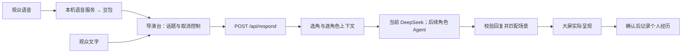

# Agent 接入交接：津门风云第二版

快照：2026-10-11。先读 README 并运行 `npm ci`、`npm test`。

## 交接目标

接手的是**观众现场说话 → 角色自动接话、连续讨论**这一版，默认 8899。固定讲稿为空。不要恢复第一版的跟稿、关键词触发或预设台词；二维兰亭的行走接口和三维是另外的任务。

用户希望将背后的角色换成独立 Agent：人格、知识、个人记忆、内部思考与决策由 Agent 负责，演示前端继续负责收音、画面、人物、气泡、取消旧输出，以及确认哪些话真正上屏了。

现有服务是 **豆包 / 火山引擎流式识别 + DeepSeek 回复**。真实密钥和正式讨论数据库均未上传，参见 [配置说明](CONFIGURATION.md)。

## 现有流程



模型返回成功不等于已经上屏：关闭大屏、场景准备失败、新话题替换、取消，都可能让草稿不出现。

## 稳定角色编号

| actor ID | 人物 |
| --- | --- |
| 0 | 梁启超 |
| 1 | 李鸿章 |
| 2 | 严复 |
| 3 | 李叔同 |
| 4 | 蔡元培 |
| 5 | 柏拉图 |
| 6 | 达芬奇 |
| 8 | 愚公 |

**7 不在当前八个角色中，不要把 8 顺移为 7。** 程序事实来源是 `knowledge/profiles.json` 与 `GET /api/live/catalog`；人物素材和场景都按这些编号绑定。

## 推荐的最小接入点

先保留选角与场景调度，替换 `backend/grounded-reply.mjs` 内逐人物的 `speak(actorId, ...)` 模型请求，从一个角色逐步接到八个。

1. `backend/character-knowledge.mjs` 的 `buildActorMessages()` 已按本人及参与者构建上下文；`config.recall(actorId, query, {participants})` 返回本人有权限复述的记忆。
2. 把 `speak()` 中 `complete(built.messages, 'actor:'+actorId)` 换为对应 Agent 调用，将响应转换回本地已有格式。
3. 保留人物编号、长度、引用来源校验和取消逻辑；服务地址与凭据只在后端配置。
4. 自动续聊、场景匹配、双气泡时序与上屏确认继续沿用现有前端。

现有逐人物模型结果：

```json
{
  "actor": 2,
  "text": "先把事实查明，意见才有立足之处。",
  "sourceIds": []
}
```

actor 必须等于请求指定人物；text 只能是真正说出口的话，实时版上限 **40 个 Unicode 字符**。sourceIds 只能引用本轮提供的来源 ID，没有合法引用就为空数组。内部计划、分析和调试信息不能拼进 text。

Agent 如果自带知识库，可以逐步接管检索，但新的引用来源需要另定格式，不能伪造当前 sourceIds。

## 整体替换的已有入口

`server.mjs` 的 `createAppServer({ generate })` 允许注入完整回复函数：

```js
async function generate(config, { text, history }, { signal }) {
  // 在这里调用接手方 Agent，并传播取消信号、校验角色及权限。
  return {
    provider: 'agents',
    model: 'your-agent-adapter',
    messages: [
      { actor: 2, text: '先把事实查明，意见才有立足之处。', replyTo: null }
    ],
    latencyMs: 0
  };
}
```

这是函数签名示意，**不是已连接好的远端 Agent**。实际适配器应返回真实耗时。最多两条回复，第一条 replyTo 为 null；第二条回应第一条时 replyTo 为 0，且两位必须不同、能够同场出现。服务端再校验并决定 sceneId，不让模型任意覆盖场景。

| config 字段 | 用途 |
| --- | --- |
| improvActors | 本轮可发言人物 |
| selectedActors | 用户手动选角，需尊重 |
| sceneCasts | 可同场出现的组合 |
| continuation | 是否原组续聊 |
| allowDiscussion / preferPair | 本轮单/双人约束 |
| recall | 本人记忆读取函数，不能用作公共记忆池 |

整体换服务还需调整 `backend/deepseek.mjs` 的配置/连接检查和导演台服务说明；现有 UI 仍标为 DeepSeek，不能只换 URL 就宣称全部接好了。

## 远端 Agent 协议建议（待接入，当前没有该路由）

可使用每人物独立的 `POST /v1/agents/{actorId}/turn`，请求包含 requestId、固定人物 ID、当前话题、合法参与者、筛选后的本人上下文、可用来源 ID 和截止时间；响应交付本轮公开台词与引用。

内部思考、长期计划和训练过程留在 Agent 后端，不进入气泡或转给其他角色。**不要将整个 history 广播给全部 Agent**，先按本人和参与者筛选。

如果 Agent 需要记住“我说过这句话”，还要接**呈现确认回调**。现有 `backend/discussion-memory.mjs` 的 `MemoryRecorder` 已通过舞台状态观察实际呈现；可在这里向 Agent 发出以 session + roundId + actor 去重的确认。生成阶段草稿不能先记成事实。这个远端回调目前尚未实现。

## 已有本机接口

| 接口 | 功能 |
| --- | --- |
| GET /api/status | 配置状态、当前模式、最近调用 |
| GET /api/live/catalog | 八角色与可用场景 |
| PUT /api/improv，{"enabled":true} | 允许回复；关闭会取消生成 |
| POST /api/respond | 本轮回复草稿，返回场景和 messages |
| GET /api/knowledge | 资料和来源摘要 |
| GET /api/memory/status、events、export | 本机已确认记忆 |
| /api/speech/status、start、audio、events、stop | 豆包识别会话，events 使用 SSE |

首轮 `/api/respond` 请求示例：

```json
{
  "text": "教育应当怎样培养独立思考？",
  "improv": true,
  "maxSpeakers": 2,
  "selectedActors": [2, 4],
  "continuation": false,
  "history": [],
  "memorySession": "本次导演台生成的会话ID"
}
```

自动选角时省略 selectedActors；lockedSceneId 有值时限制在该场景。续聊由现有前端携带已上屏的 memoryRoundId，服务端重建可信历史。不要构造假历史跳过确认。这个请求只生成草稿，不负责送到大屏。

## 必须保留的约束

- 取消信号传到 Agent 请求，新话题、停止、换会话后，迟到回复不能补播。
- 只检索本人实际参与且可对当前听众复述的记忆，新加入者不继承旧组私聊。
- 生成、排队、取消或未显示的台词不记成经历；上屏确认要幂等。
- 人物、场景、气泡仍由展示端管理，不让模型随意覆盖已编辑的布局。
- 当前知识回复预算约 7 秒，导演台请求约 10 秒。更慢的 Agent 需协调两边超时和等待状态，不能只延长后端。
- 沿用 `auto-discussion.js` 的最新话题与取消代次，不能积压无限旧话题。

## 验收顺序

1. 无密钥运行 `npm ci`、`npm test`，确认素材和两页可启动。
2. 用模拟 Agent 先接一个人，测试成功、超时、错误 ID、超长文本、取消后迟到。
3. 配置自己的 Agent，以文字话题验证一人、两人回复和气泡避脸。
4. 检查未显示回复不写记忆，新人物看不到旧私聊。
5. 最后使用豆包在实际设备收音，测试新话题打断和连续讨论。

重点测试：`tests/realtime-edition.test.mjs`、`tests/character-knowledge.test.mjs`、`tests/memory-isolation.test.mjs`、`tests/auto-discussion.test.cjs`、`tests/live-bubble-faces.test.cjs`。
